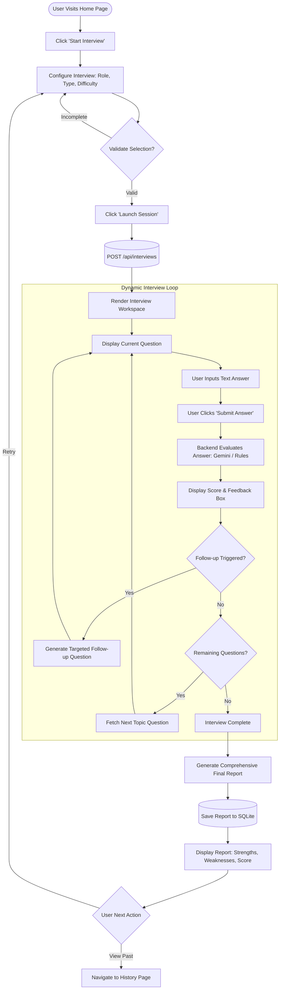
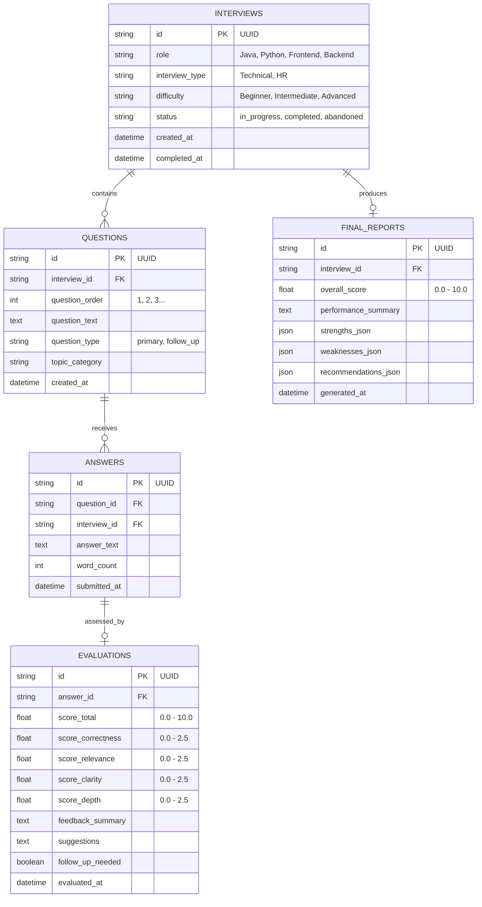

# INTERVIEWX – AI Interview Simulator
## Product Requirements Document (PRD)

---

| **Document Version** | 1.0.0 |
| :--- | :--- |
| **Status** | Draft for Review (Phase 1) |
| **Target Audience** | Developers, Designers, QA, Project Stakeholders |
| **Project Lead / Author** | Antigravity AI & Engineering Pair |
| **Date** | November 2026 |

---

## Table of Contents
1. [Executive Summary & Project Vision](#1-executive-summary--project-vision)
2. [Beginner-Friendly Architecture Explanation](#2-beginner-friendly-architecture-explanation)
3. [Target Roles, Interview Types & Difficulty Matrix](#3-target-roles-interview-types--difficulty-matrix)
4. [Functional Requirements (FRD)](#4-functional-requirements-frd)
5. [Non-Functional Requirements (NFRD)](#5-non-functional-requirements-nfrd)
6. [Design System & UI/UX Requirements](#6-design-system--uiux-requirements)
7. [User Flow & Journey Maps](#7-user-flow--journey-maps)
8. [Database Architecture & Data Models (SQLite)](#8-database-architecture--data-models-sqlite)
9. [Backend API Specification (FastAPI)](#9-backend-api-specification-fastapi)
10. [AI Evaluation & Prompt Engineering Strategy (Gemini API)](#10-ai-evaluation--prompt-engineering-strategy-gemini-api)
11. [Project Structure & Code Organization](#11-project-structure--code-organization)
12. [Phased Development Roadmap](#12-phased-development-roadmap)
13. [Verification & Acceptance Criteria](#13-verification--acceptance-criteria)

---

## 1. Executive Summary & Project Vision

### 1.1 Project Objective
**INTERVIEWX** is an intelligent, automated interview practice platform engineered to simulate high-fidelity technical and human resources (HR) interviews. By assuming the persona of a senior technical interviewer or experienced talent acquisition specialist, INTERVIEWX engages candidates in structured question-and-answer sessions, dynamically probes answers with context-aware follow-ups, and delivers granular, objective performance critiques.

### 1.2 Core Value Proposition
- **Realistic Interactive Simulation**: Replaces static flashcards and generic question lists with dynamic conversational interviews.
- **Multi-Dimensional Evaluation**: Evaluates answers on four core pillars: *Correctness*, *Relevance*, *Clarity*, and *Technical Depth*.
- **Adaptive Follow-Up System**: Generates natural follow-up inquiries that challenge shallow answers or explore interesting insights shared by the candidate.
- **Actionable Performance Reports**: Provides candidates with diagnostic reports that highlight exact strengths, weaknesses, and concrete learning recommendations.
- **Progress Tracking**: Maintains session history so candidates can monitor score trends over time.

---

## 2. Beginner-Friendly Architecture Explanation

If you are new to full-stack web applications and AI engineering, here is a simple breakdown of how INTERVIEWX operates under the hood.

```
       +-------------------------------------------------------+
       |               CANDIDATE'S BROWSER                     |
       |  (React Single Page App - HTML, CSS, JavaScript)      |
       +-------------------------------------------------------+
                                   |
                         HTTP REST API Requests
                         (JSON Payloads / Axios)
                                   v
       +-------------------------------------------------------+
       |                 FASTAPI BACKEND                       |
       |            (Python Asynchronous Server)               |
       |                                                       |
       |   * Session Manager       * Scoring & Evaluation      |
       |   * Prompt Constructor    * Database Controllers      |
       +-------------------------------------------------------+
                     |                           |
         Reads & Writes Records         Sends Prompts & Receives
                     |                   Structured JSON Critique
                     v                           v
       +---------------------------+   +-----------------------+
       |      SQLITE DATABASE      |   |   GOOGLE GEMINI API   |
       |   (Local Relational DB)   |   |   (LLM Intelligence)  |
       +---------------------------+   +-----------------------+
```

### 2.1 The Analogy: A Physical Interview Office
Think of INTERVIEWX as an actual interview room:
1. **The Candidate Lobby & Room (The Frontend - React)**:
   This is what the user sees on their screen. It's the desk, the questions displayed on paper, the timer, and the text box where the candidate writes their answers. It communicates with the front desk via notes (HTTP Requests).
2. **The Front Desk & Interview Coordinator (The Backend - Python FastAPI)**:
   The coordinator receives the candidate's answers, ensures the rules are followed, checks the database for previous questions, and passes the candidate's answer to the senior evaluator.
3. **The File Cabinet (The Database - SQLite)**:
   A lightweight, self-contained file stored right on the server that keeps a safe record of every interview session, question asked, answer submitted, score earned, and final report generated.
4. **The Senior Interview Specialist (The AI - Google Gemini API)**:
   A powerful cognitive model that acts as the evaluator. The coordinator feeds it the job role, current question, and candidate's answer. The AI assesses the response, provides a score out of 10, writes helpful feedback, and decides whether to ask a follow-up or move to the next topic.

### 2.2 Why This Stack Was Chosen
- **React (Frontend)**: Highly responsive component-driven interface, smooth state updates without page reloads, and easy-to-manage interactive components (timers, score badges, dynamic chat bubbles).
- **Python + FastAPI (Backend)**: Extremely fast execution, native asynchronous support (`async`/`await`), built-in data validation using Pydantic, and native compatibility with Python's AI/ML ecosystem.
- **SQLite (Database)**: Zero-configuration, zero-cost, serverless relational database engine stored as a single file. Perfect for local development, fast prototyping, and portable deployments.
- **Google Gemini API (AI)**: High reasoning capacity, structured JSON output mode, low latency, and cost-effective performance for technical evaluations.

---

## 3. Target Roles, Interview Types & Difficulty Matrix

INTERVIEWX supports a calibrated configuration matrix tailored to specific job market standards.

### 3.1 Supported Job Roles
1. **Java Developer**: Core Java (OOP, Collections, Multithreading, Memory Management), Spring Boot, Hibernate/JPA, RESTful APIs, JVM internals, Microservices patterns.
2. **Python Developer**: Core Python (Data structures, Decorators, Generators, Asyncio), Django/FastAPI, ORM, clean code, API development, performance optimization.
3. **Frontend Developer**: Modern JavaScript (ES6+), React ecosystem (State management, Hooks, Virtual DOM, Lifecycle), HTML5/CSS3 semantics, Web Performance, Responsive Design, Accessibility (a11y).
4. **Backend Developer**: System design basics, REST/gRPC APIs, Database optimization (Indexing, Transactions), Caching (Redis), Authentication/Authorization (JWT, OAuth), Reliability and Scalability.

### 3.2 Interview Types
- **Technical Interview**: Focuses on algorithmic thinking, language syntax, framework knowledge, architecture trade-offs, debugging scenarios, and code design principles.
- **HR / Behavioral Interview**: Focuses on communication, conflict resolution, cultural fit, team collaboration, leadership, problem handling, and the STAR methodology (Situation, Task, Action, Result).

### 3.3 Difficulty Levels
| Level | Target Candidate | Question Depth & Evaluation Expectations |
| :--- | :--- | :--- |
| **Beginner** | 0 - 2 Years (Junior / Fresh Grad) | Fundamental concepts, basic definitions, standard syntax, straightforward scenarios, core language semantics. |
| **Intermediate**| 2 - 5 Years (Mid-level) | Practical application, trade-offs, edge-case handling, framework internals, performance considerations, error management. |
| **Advanced** | 5+ Years (Senior / Lead) | Architectural design, distributed systems, deep memory/concurrency models, scalability bottlenecks, high-stakes trade-offs, leadership impact. |

---

## 4. Functional Requirements (FRD)

### 4.1 Module 1: Home Page & Landing Experience
- **FR-1.1**: Display platform title, value proposition, and an overview of features.
- **FR-1.2**: Prominent call-to-action (CTA) button: **"Start Interview"** which routes the user to the configuration page.
- **FR-1.3**: Quick access navigation bar linking to:
  - *Home*
  - *New Interview*
  - *Interview History*
- **FR-1.4**: Brief highlights section showing how AI scoring works (Evaluation pillars, instant feedback, comprehensive reports).

### 4.2 Module 2: Interview Setup & Configuration
- **FR-2.1**: Interactive selection cards for:
  - **Job Role**: Java Developer | Python Developer | Frontend Developer | Backend Developer.
  - **Interview Type**: Technical Interview | HR Interview.
  - **Difficulty Level**: Beginner | Intermediate | Advanced.
- **FR-2.2**: Form validation ensuring all 3 parameters are chosen before enabling the **"Launch Interview Session"** button.
- **FR-2.3**: Clear summary card showing the selected configuration before starting.
- **FR-2.4**: API call to backend to initialize a session and obtain Session ID.

### 4.3 Module 3: AI Interview Workspace (Room)
- **FR-3.1**: Clean, distraction-free interview console presenting:
  - Header with Job Role badge, Interview Type badge, Difficulty badge, and Question Counter (e.g., `Question 3 of 5`).
  - Active Interviewer message box presenting the current question clearly.
  - An indicator showing whether the current question is a **Primary Question** or an **AI Follow-up Question**.
- **FR-3.2**: Multi-line answer input text area with:
  - Character and word counter.
  - Placeholder guidance (e.g., *"Provide a structured answer with technical specifics or examples..."*).
  - Clean keyboard shortcuts (e.g., `Ctrl + Enter` to submit).
- **FR-3.3**: Interactive submission controls:
  - **"Submit Answer"** button.
  - Visual loading indicator (skeleton loader / subtle pulsing animation) during AI evaluation.
- **FR-3.4**: Session exit confirmation modal if the user attempts to leave mid-session.

### 4.4 Module 4: Answer Evaluation & Feedback Display
- **FR-4.1**: Instant evaluation after each answer submission displaying:
  - **Score**: Numerical score out of 10 (e.g., `7.5 / 10`).
  - **Feedback Summary**: 2-3 sentences summarizing the overall quality of the response.
  - **Dimensional Breakdown**:
    - *Correctness* (0 - 2.5)
    - *Relevance* (0 - 2.5)
    - *Clarity* (0 - 2.5)
    - *Technical Depth* (0 - 2.5)
  - **Actionable Suggestions**: Concrete pointers on how the candidate could improve the answer.
- **FR-4.2**: Once reviewed, a **"Next Question"** button advances the interview loop.

### 4.5 Module 5: Contextual Follow-Up Question Logic
- **FR-5.1**: Backend evaluation engine determines whether a follow-up question is warranted:
  - If an answer lacks depth, misses a critical concept, or introduces an interesting claim, the system generates 1 targeted follow-up question.
  - Maximum of 1 follow-up question per main question to keep interview length predictable (standard session: 5 main questions + up to 2 follow-ups total).
- **FR-5.2**: Follow-up questions explicitly reference the candidate's previous response to feel organic and attentive.

### 4.6 Module 6: Final Interview Diagnostic Report
- **FR-6.1**: Triggers automatically upon completion of the final question.
- **FR-6.2**: Comprehensive executive summary containing:
  - **Aggregate Score**: Average score out of 10 and performance rating (e.g., *Beginner Passing*, *Job Ready*, *Needs Improvement*).
  - **Candidate Strengths**: Bulleted list of proven competencies demonstrated across the interview.
  - **Areas for Improvement**: Specific topics, concepts, or communication gaps noted.
  - **Actionable Learning Roadmap**: Curated advice and topics to study next.
  - **Question-by-Question Review**: Collapsible accordion list of all questions, candidate answers, scores, and specific critiques.
- **FR-6.3**: Actions on Report:
  - Button to **"Retake Interview"**.
  - Button to **"Go to History"**.

### 4.7 Module 7: Interview History & Progress Tracking
- **FR-7.1**: Chronological list of all completed interview sessions retrieved from the SQLite database.
- **FR-7.2**: Table/Card layout displaying:
  - Date & Timestamp
  - Role, Type, and Difficulty
  - Questions Answered count
  - Final Average Score badge (color-coded: Green for 8-10, Amber for 5-7.9, Rose for 0-4.9)
  - Link to view the complete saved Final Report.
- **FR-7.3**: Option to delete an individual session from history with a confirmation prompt.

---

## 5. Non-Functional Requirements (NFRD)

### 5.1 Performance & Latency
- **Page Load Time**: Initial frontend load < 1.5 seconds on broadband connections.
- **API Response Time**: Backend endpoints (excluding external LLM calls) must respond in < 100ms.
- **AI Evaluation Latency**: AI generation calls should aim for < 4.0 seconds latency, with clear frontend visual loading feedback to maintain user engagement.

### 5.2 Security & Data Integrity
- **Zero Hardcoded Secrets**: Gemini API keys and sensitive configuration must reside strictly in server-side `.env` files and never be exposed in client bundles or public commits.
- **Input Sanitization**: All user inputs must be trimmed and validated against empty submissions, XSS vulnerabilities, and payload size limits (e.g., maximum 5,000 characters per answer).
- **Environment Isolation**: Separate development and production settings.

### 5.3 Usability & Accessibility
- **WCAG 2.1 AA Compliance**: High-contrast ratios between text and backgrounds (especially against dark navy backgrounds).
- **Responsive Layout**: Fluid experience across mobile phones (360px+), tablets (768px+), and desktops (1024px to 4K).
- **Error Resilience**: User-friendly notifications when the network disconnects or API limits are encountered.

### 5.4 Transparency & Honesty in AI Operation
- The application will **never** present mocked or hardcoded sample evaluations as "live AI analysis".
- Prior to Gemini API enablement (Phase 4), the application will operate in an explicit, clearly labeled **"Structured Mock / Development Mode"** to test UI and data flow transparently.

---

## 6. Design System & UI/UX Requirements

INTERVIEWX uses an authoritative, professional visual language tailored for executive career preparation.

### 6.1 Color Palette
| Token Name | Hex Code | Purpose & Usage |
| :--- | :--- | :--- |
| **Primary Navy** | `#0F172A` (Slate 900) | Primary background for dark headers, footers, deep hero cards. |
| **Secondary Navy**| `#1E293B` (Slate 800) | Sidebar, elevated cards, modal headers, borders. |
| **Pure White** | `#FFFFFF` | Core content container background, card surfaces, clean canvas. |
| **Canvas Off-White**| `#F8FAFC` (Slate 50) | General application page background. |
| **Subtle Purple** | `#7C3AED` (Violet 600) | Brand accent, primary action buttons, active indicator rings. |
| **Purple Soft Glow**| `#EDE9FE` (Violet 100) | Selected radio backgrounds, hover states, pill badges. |
| **Success Emerald**| `#10B981` (Emerald 500)| High scores (8-10), passed criteria, positive feedback. |
| **Warning Amber** | `#F59E0B` (Amber 500) | Moderate scores (5-7.9), suggestions, caution notes. |
| **Danger Rose** | `#EF4444` (Rose 500) | Low scores (<5), errors, delete action buttons. |
| **Text Primary** | `#0F172A` | Primary body and headline text on light backgrounds. |
| **Text Secondary**| `#64748B` (Slate 500) | Subtitles, helper text, timestamps, character counts. |

### 6.2 Typography
- **Primary Typeface**: `Inter`, `-apple-system`, `BlinkMacSystemFont`, `Segoe UI`, `Roboto`, `sans-serif`.
- **Heading Scale**:
  - H1: 32px / 2rem, Bold (Hero headlines, Report titles)
  - H2: 24px / 1.5rem, Semi-Bold (Section titles, card headers)
  - H3: 18px / 1.125rem, Medium (Question headers, sub-metrics)
- **Body Scale**:
  - Body Regular: 15px / 0.9375rem, Regular (Answers, feedback text)
  - Small / Caption: 13px / 0.8125rem, Regular (Metadata, tags, tooltips)

### 6.3 Components & Visual Hierarchy
- **Cards**: Border radius `12px`, subtle border `1px solid #E2E8F0`, soft elevation shadow `0 4px 6px -1px rgba(0, 0, 0, 0.05)`.
- **Primary Buttons**: Background `#7C3AED`, color `#FFFFFF`, border-radius `8px`, hover effect `background: #6D28D9`, subtle transition `all 0.2s ease-in-out`.
- **Progress Bars**: 8px height, rounded pill shape, background `#E2E8F0`, filled with subtle gradient `#7C3AED` to `#6366F1`.
- **Badges**: Pill-shaped with subtle tinted backgrounds and solid text (e.g., Violet pill for "Java Developer").

---

## 7. User Flow & Journey Maps

### 7.1 Complete End-to-End User Journey



---

## 8. Database Architecture & Data Models (SQLite)

The database schema is normalized and designed with referential integrity. It records every interaction to power the history and reporting engines.

### 8.1 Entity Relationship Diagram



### 8.2 Detailed Table Specifications

#### Table: `interviews`
| Column | Type | Constraints | Description |
| :--- | :--- | :--- | :--- |
| `id` | TEXT | PRIMARY KEY | UUID v4 string |
| `role` | TEXT | NOT NULL | Job role selected |
| `interview_type` | TEXT | NOT NULL | "Technical" or "HR" |
| `difficulty` | TEXT | NOT NULL | "Beginner", "Intermediate", or "Advanced" |
| `status` | TEXT | DEFAULT 'in_progress' | 'in_progress', 'completed', 'abandoned' |
| `created_at` | TIMESTAMP | DEFAULT CURRENT_TIMESTAMP | Creation timestamp |
| `completed_at` | TIMESTAMP | NULLABLE | Completion timestamp |

#### Table: `questions`
| Column | Type | Constraints | Description |
| :--- | :--- | :--- | :--- |
| `id` | TEXT | PRIMARY KEY | UUID v4 string |
| `interview_id` | TEXT | FOREIGN KEY (`interviews.id`) | Belongs to session |
| `question_order`| INTEGER | NOT NULL | 1-based order in sequence |
| `question_text` | TEXT | NOT NULL | The prompt/question text |
| `question_type` | TEXT | DEFAULT 'primary' | 'primary' or 'follow_up' |
| `topic_category`| TEXT | NULLABLE | E.g., 'Concurrency', 'STAR-Conflict' |
| `created_at` | TIMESTAMP | DEFAULT CURRENT_TIMESTAMP | Created timestamp |

#### Table: `answers`
| Column | Type | Constraints | Description |
| :--- | :--- | :--- | :--- |
| `id` | TEXT | PRIMARY KEY | UUID v4 string |
| `question_id` | TEXT | FOREIGN KEY (`questions.id`) | Target question |
| `interview_id` | TEXT | FOREIGN KEY (`interviews.id`) | Target session |
| `answer_text` | TEXT | NOT NULL | Candidate's submitted text |
| `word_count` | INTEGER | NOT NULL | Total words in answer |
| `submitted_at` | TIMESTAMP | DEFAULT CURRENT_TIMESTAMP | Submission timestamp |

#### Table: `evaluations`
| Column | Type | Constraints | Description |
| :--- | :--- | :--- | :--- |
| `id` | TEXT | PRIMARY KEY | UUID v4 string |
| `answer_id` | TEXT | FOREIGN KEY (`answers.id`) | Target answer |
| `score_total` | REAL | NOT NULL | Composite score 0.0 to 10.0 |
| `score_correctness`| REAL| NOT NULL | Correctness 0.0 to 2.5 |
| `score_relevance` | REAL | NOT NULL | Relevance 0.0 to 2.5 |
| `score_clarity` | REAL | NOT NULL | Clarity 0.0 to 2.5 |
| `score_depth` | REAL | NOT NULL | Depth 0.0 to 2.5 |
| `feedback_summary`| TEXT | NOT NULL | 2-3 sentence overview |
| `suggestions` | TEXT | NOT NULL | Actionable advice |
| `follow_up_needed`| BOOLEAN| DEFAULT 0 | Whether follow-up was triggered |
| `evaluated_at` | TIMESTAMP| DEFAULT CURRENT_TIMESTAMP | Evaluation timestamp |

#### Table: `final_reports`
| Column | Type | Constraints | Description |
| :--- | :--- | :--- | :--- |
| `id` | TEXT | PRIMARY KEY | UUID v4 string |
| `interview_id` | TEXT | UNIQUE, FOREIGN KEY (`interviews.id`) | One report per session |
| `overall_score`| REAL | NOT NULL | Cumulative average score |
| `performance_summary` | TEXT | NOT NULL | Qualitative summary |
| `strengths_json`| TEXT | NOT NULL | JSON string array of strengths |
| `weaknesses_json`| TEXT| NOT NULL | JSON string array of weaknesses |
| `recommendations_json`| TEXT | NOT NULL | JSON string array of next steps |
| `generated_at` | TIMESTAMP| DEFAULT CURRENT_TIMESTAMP | Generation timestamp |

---

## 9. Backend API Specification (FastAPI)

All endpoints accept and return `application/json`. Standard error formats adhere to RFC 7807 problem details.

### 9.1 Session Management Endpoints
- `POST /api/interviews`
  - **Purpose**: Initialize a new interview session.
  - **Request Body**:
    ```json
    {
      "role": "Java Developer",
      "interview_type": "Technical",
      "difficulty": "Intermediate"
    }
    ```
  - **Response (201 Created)**:
    ```json
    {
      "interview_id": "9b1deb4d-3b7d-4bad-9bdd-2b0d7b3dcb6d",
      "role": "Java Developer",
      "interview_type": "Technical",
      "difficulty": "Intermediate",
      "status": "in_progress",
      "total_questions_planned": 5,
      "first_question": {
        "id": "e4eaaaf2-d142-11e1-b3e4-080027620cdd",
        "question_order": 1,
        "question_text": "Can you explain how Java's Garbage Collection mechanism works, specifically the difference between the Young and Old generations?",
        "question_type": "primary"
      }
    }
    ```

- `GET /api/interviews/{interview_id}`
  - **Purpose**: Get session state, answered questions count, and status.

### 9.2 Q&A and Evaluation Endpoints
- `POST /api/interviews/{interview_id}/answers`
  - **Purpose**: Submit the candidate's answer for the active question, trigger AI evaluation, and receive instant score/feedback.
  - **Request Body**:
    ```json
    {
      "question_id": "e4eaaaf2-d142-11e1-b3e4-080027620cdd",
      "answer_text": "Garbage collection in Java automatically frees memory by deleting objects that are no longer reachable from any root pointer. Memory is split into Young and Old generations..."
    }
    ```
  - **Response (200 OK)**:
    ```json
    {
      "evaluation": {
        "score_total": 8.0,
        "score_correctness": 2.0,
        "score_relevance": 2.0,
        "score_clarity": 2.0,
        "score_depth": 2.0,
        "feedback_summary": "Strong foundational explanation of root reachability and generational heap division.",
        "suggestions": "To reach advanced depth, mention specific collectors like G1 or ZGC and explain what triggers a 'Stop-the-World' event."
      },
      "next_action": "next_question", 
      "next_question": {
        "id": "f5baaaf2-d142-11e1-b3e4-080027620cee",
        "question_order": 2,
        "question_text": "How does Java ensure thread safety when multiple threads access a shared collection like HashMap?",
        "question_type": "primary"
      }
    }
    ```

### 9.3 Report & History Endpoints
- `POST /api/interviews/{interview_id}/complete`
  - **Purpose**: Conclude an interview session and generate the final diagnostic report.
  - **Response (200 OK)**: Full report object including overall score, strengths, weaknesses, and recommendations.

- `GET /api/interviews/{interview_id}/report`
  - **Purpose**: Retrieve the final report for an interview session.

- `GET /api/interviews`
  - **Purpose**: Fetch interview history (supports pagination e.g., `?limit=10&offset=0`).

- `DELETE /api/interviews/{interview_id}`
  - **Purpose**: Remove a session and its associated answers from the database.

---

## 10. AI Evaluation & Prompt Engineering Strategy (Gemini API)

*(To be implemented in Phase 4 of the roadmap. Until Phase 4, deterministic local mock evaluators will be utilized).*

### 10.1 Evaluation Rubric
All answers are evaluated against a standardized 10-point scale:

$$\text{Total Score} = \text{Correctness} + \text{Relevance} + \text{Clarity} + \text{Technical Depth}$$

1. **Correctness (0.0 - 2.5 pts)**:
   - Factual and technical accuracy of definitions, mechanisms, and syntax.
2. **Relevance (0.0 - 2.5 pts)**:
   - Direct addressing of the specific prompt without off-topic filler.
3. **Clarity (0.0 - 2.5 pts)**:
   - Structural flow, articulation, readability, and professional phrasing.
4. **Technical Depth (0.0 - 2.5 pts)**:
   - Discussion of architectural trade-offs, edge cases, underlying mechanics, and production best practices.

### 10.2 System Persona Prompt Specification
```markdown
You are a Principal Software Engineering & HR Interview Specialist at a premier technology company.
Your persona is objective, constructive, professional, and encouraging.
You are conducting an interview for a candidate applying for: {ROLE} at {DIFFICULTY} level.
The interview format is: {INTERVIEW_TYPE}.

Your task is to:
1. Objectively evaluate the candidate's answer to the given question.
2. Score the answer strictly according to the 4 dimensional criteria (Correctness, Relevance, Clarity, Technical Depth).
3. Provide concise feedback (2-3 sentences) and 1-2 actionable suggestions for improvement.
4. If the candidate's response introduces an incomplete thought or an intriguing claim, generate a follow-up question. Otherwise set follow_up_needed to false.

Respond ONLY in valid, parseable JSON matching the requested schema.
```

### 10.3 Structured Output JSON Schema for Gemini
```json
{
  "score_total": 7.5,
  "score_correctness": 2.0,
  "score_relevance": 2.0,
  "score_clarity": 2.0,
  "score_depth": 1.5,
  "feedback_summary": "Good explanation of basic concepts, but missed key edge cases.",
  "suggestions": "Review edge conditions such as null handling and concurrent modification exceptions.",
  "follow_up_needed": false,
  "follow_up_question": null
}
```

---

## 11. Project Structure & Code Organization

The project strictly separates the React client from the FastAPI backend to ensure maintainability, independent deployment capability, and clean separation of concerns.

```
INTERVIEWX/
├── PRD.md                                # Product Requirements Document
├── README.md                             # Quickstart & setup documentation
├── .gitignore                            # Git ignore patterns
│
├── backend/                              # Python FastAPI Application
│   ├── .env.example                      # Template for environment variables (GEMINI_API_KEY)
│   ├── requirements.txt                  # Python dependencies (fastapi, uvicorn, sqlalchemy, etc.)
│   ├── main.py                           # FastAPI application entry point & CORS configuration
│   ├── config.py                         # Pydantic BaseSettings config reader
│   │
│   ├── database/
│   │   ├── __init__.py
│   │   ├── session.py                    # SQLite engine and session maker
│   │   └── models.py                     # SQLAlchemy ORM models (Interview, Question, Answer, etc.)
│   │
│   ├── schemas/
│   │   ├── __init__.py
│   │   ├── interview.py                  # Pydantic schemas for requests and responses
│   │   └── evaluation.py                 # Schemas for feedback and report payloads
│   │
│   ├── services/
│   │   ├── __init__.py
│   │   ├── interview_service.py          # Session business logic & workflow orchestration
│   │   ├── ai_service.py                 # Gemini API integration wrapper
│   │   └── question_bank.py              # Curated seed questions for Technical & HR roles
│   │
│   └── routers/
│       ├── __init__.py
│       ├── interview_router.py           # Endpoints for creating and progressing interviews
│       └── report_router.py              # Endpoints for reports and history
│
└── frontend/                             # React Application
    ├── package.json                      # Frontend dependencies and scripts
    ├── index.html                        # Application entry HTML
    ├── vite.config.js                    # Vite configuration & proxy settings
    ├── src/
    │   ├── main.jsx                      # React DOM root render
    │   ├── App.jsx                       # Root routing setup (Home, Setup, Room, Report, History)
    │   ├── App.css                       # Global styles, variables, typography
    │   │
    │   ├── assets/                       # Static SVGs, icons, illustrations
    │   │
    │   ├── components/                   # Reusable UI components
    │   │   ├── Navbar.jsx                # Top navigation header
    │   │   ├── Footer.jsx                # Application footer
    │   │   ├── ScoreBadge.jsx            # Color-coded score indicators
    │   │   ├── ProgressBar.jsx           # Interview step progress bar
    │   │   ├── FeedbackCard.jsx          # Answer critique & score display
    │   │   └── QuestionCard.jsx          # Interviewer prompt card
    │   │
    │   ├── pages/                        # Page-level components
    │   │   ├── HomePage.jsx              # Landing page
    │   │   ├── SetupPage.jsx             # Role/Type/Difficulty configuration
    │   │   ├── InterviewRoomPage.jsx     # Active interview Q&A interface
    │   │   ├── ReportPage.jsx            # Detailed performance diagnostic report
    │   │   └── HistoryPage.jsx           # Past interview records table
    │   │
    │   └── services/
    │       └── api.js                    # Axios / Fetch client methods for backend communication
```

---

## 12. Phased Development Roadmap

To ensure code stability, zero hardcoded secrets, and no fake claims, development will strictly follow these chronological phases:

| Phase | Milestone | Deliverables & Focus |
| :---: | :--- | :--- |
| **Phase 1** | **PRD & Architecture Approval** *(Current)* | Detailed PRD creation, user review, alignment on scope and data contracts. |
| **Phase 2** | **Project Setup & Base Infrastructure** | Repository setup, Python virtual environment, FastAPI setup with SQLite models, and basic React frontend scaffolding with design tokens. |
| **Phase 3** | **Core UI & Local Mock Flow** | Complete UI implementation (Home, Setup, Room, Report, History) connecting to backend with a structured local Question Bank. Candidate can complete full interview cycles without AI keys. |
| **Phase 4** | **Gemini AI Integration** | Implement `ai_service.py` using official Google GenAI SDK. Configure system prompts, structured JSON output validation, and secure `.env` key loading. |
| **Phase 5** | **Evaluation & Dynamic Follow-up Engine** | Connect live AI evaluation for submitted answers. Validate 10-point scoring accuracy, suggestions, and context-aware follow-up question generation. |
| **Phase 6** | **History, Diagnostics & Edge Polish** | SQLite history persistence, session resume or delete, performance optimization, responsive testing across desktop and mobile. |

---

## 13. Verification & Acceptance Criteria

Before any release is marked complete, the following acceptance criteria must be satisfied:

1. **Role & Type Coverage**: All 4 roles (Java, Python, Frontend, Backend) across both Technical and HR types at 3 difficulty levels must successfully load relevant questions.
2. **Scoring Consistency**: Evaluations strictly adhere to the 4 dimensional criteria (Correctness, Relevance, Clarity, Depth), summing to an exact 10-point scale.
3. **Contextual Follow-ups**: Follow-up questions must directly reference the candidate's prior answer and challenge a specific statement or explore depth.
4. **Data Persistence**: Refreshing the browser or returning to the History page must reliably preserve past completed interviews with complete reports.
5. **Security & Secrets**: Zero API keys or secrets in client-side code or git tracking.
6. **Responsiveness**: All pages must render without horizontal scrollbars or broken layouts on standard mobile viewports (375px+).

---
*End of Product Requirements Document.*

